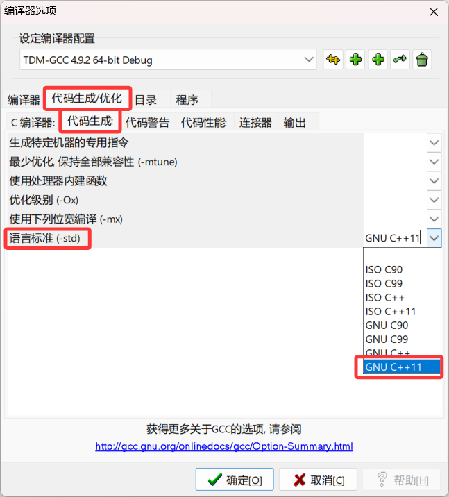

## C++ 简介

学习完 C 语言的基本语法并做了足够的练习之后，就可以开始学习 C++ 了。

C/C++ 语法同源，但 C++ 正如他的名字一样，是在 C 语言的基础上增加了一些内容，在后续的练习中将使用 C++，这个阶段需要简单学习 C++ 的知识。

C++ 是面向对象程序设计语言，这一点与 C 作为面向过程程序设计语言不同。但是对于备战程序设计类竞赛（算法竞赛），我们不需要对面向对象的概念做过多了解，了解类封装等基本方法即可。

转换到 C++ 主要学习的知识有：cin/cout 对象，C++ STL（string 容器，queue 容器，stack 容器，map 容器，set 容器）。后续学习高级数据结构、图论等知识时再学习类封装。

为什么要先学 C 再学 C++，而不是直接学 C++？一方面，正如上文所述，C++ 的语法和 C 有很多相同之处；另一方面，经验告诉我们，自学者先学 C 后学 C++，比直接自学 C++ 更容易接受，因为 C 语言有更好的免费课程（翁恺）。

???+ note
    
    如果你使用 Dev-C++，为了使用 C++11 及更高版本的功能，请在编译选项中启用 C++11 编译支持。
    
    <figure markdown="span">
        { width="50%" }
    </figure>

## 了解 C++ 和 C 的区别

建议观看本视频：[C语言 转 C++ 简单教程](https://www.bilibili.com/video/BV1UE411j7Ti/) 

同时阅读 OI-Wiki 上 [语言基础](https://oi-wiki.org/lang/) 章节，并着重阅读学习 [C++ 语法基础](https://oi-wiki.org/lang/basic/)、[STL 容器](https://oi-wiki.org/lang/csl/container/)、[STL 算法](https://oi-wiki.org/lang/csl/algorithm/)、[string](https://oi-wiki.org/lang/csl/string/) 几个小节（STL 容器及算法可先不学习）。特别是 string 类型，在今后的刷题中经常使用。

学习 C++ 语法期间，花 **2~3 天** 将之前写过的题目用 C++ 再写一次。

## 学习 C++ STL

阅读上面的几个和 C++ STL 相关的章节。也可以观看此视频：[【C++】算法竞赛常用 STL 用法](https://www.bilibili.com/video/BV1L8411y7th/) 