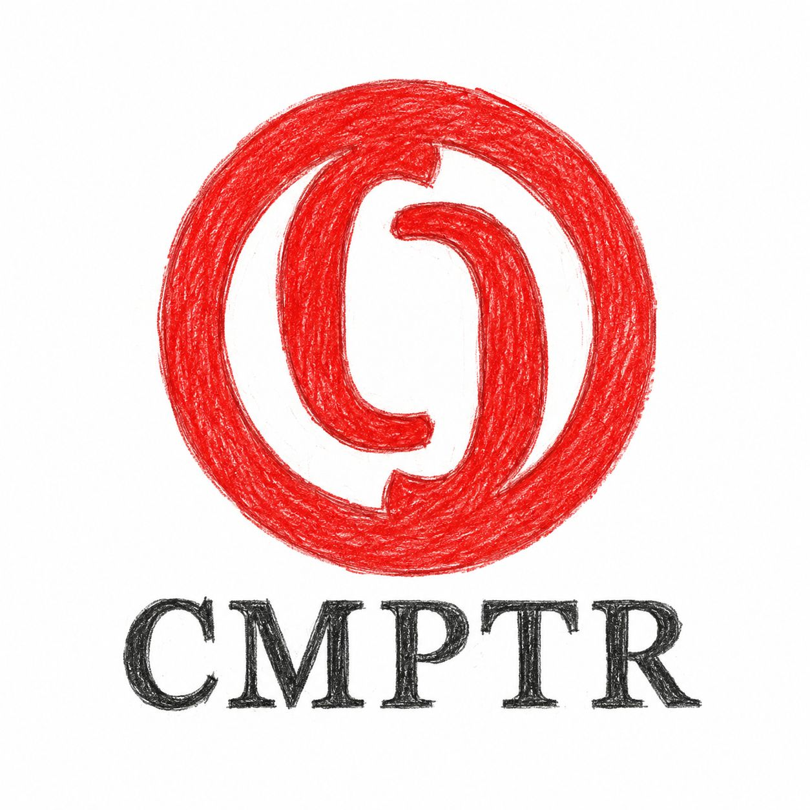
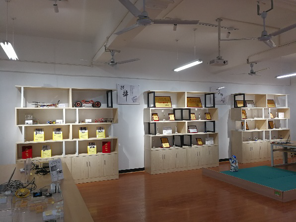
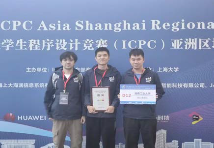

title: HUTACM Docs

## Welcome to HUTACM Docs

<figure markdown="span">
  { width="40%" }
</figure>

<a href="https://acm.hut.edu.cn/" target="_blank">前往 HUTOJ</a> &emsp; [学习指南](guide) &emsp; [加入我们](#_1)

**湖南工业大学计算机学院大学生创新创业教育中心**（创新创业实验室）源于学院 2006 年成立的创新实验室，2012 年中心获批为省级大学生创新平台，2016 年续批为省级信息技术大学生创新创业教育中心，2019 年续批为省级计算机类大学生创新创业教育中心，同时拥有校级创新创业实验班 1 个。

中心目前有学员 150 余人，指导教师近 20 余人，下设 ACM-ICPC 竞赛组、IoT 应用开发组、机器人创新组和移动应用开发组等 11 个[兴趣小组](intro/groups)。中心可容纳 300 余名师生同时开展创新创业教育，具备全年不间断（含假期）接受学生进行训练的能力。专用创新创业教育校内场地面积达 500 多平方米。

中心以全面培养具有高素质的计算机类应用型人才为目标，在注重理论知识学习的同时，强化实践技能、突出动手能力。每年中心统一组织学员参与多项学科和创新创业大赛，并与地方企业开展校企合作或技术服务，提供实际项目让学员参与，着力提升学员创新创业能力。中心在人才培养方面取得了丰硕成果，毕业的学生综合素质高，进入腾讯、阿里巴巴、百度、字节跳动、快手等知名 IT 企业的人数逐年提升，受到用人单位的好评。

<figure markdown="span">
  { width="80%" }
  <figcaption>中心专用多功能室</figcaption>
  
  <figcaption>学员获 ACM-ICPC 亚洲区域赛银奖</figcaption>
</figure>

## 加入双创中心

我们欢迎有远大志向、敢于拼搏的同学加入我们的队伍！如果您已下决心加入双创中心（实验室），请阅读接下来的章节了解我们的[招新流程和选拔规则](intro/selection)，并阅读我们编写的[学习指南](guide)，走上成为大佬之路吧！
