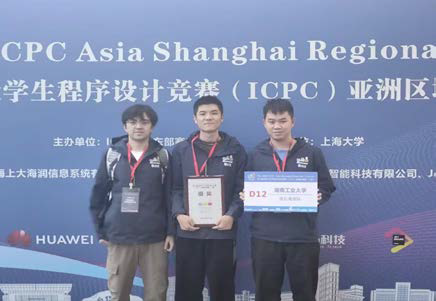
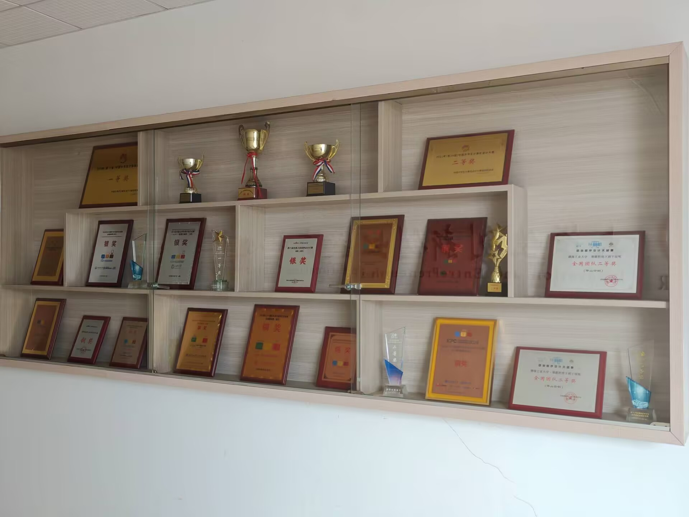
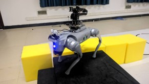

!!! info

    本页的内容需要更新，但仍具有参考价值。

## ACM-ICPC 竞赛组

### 基本情况

**ACM-ICPC**（International Collegiate Programming Contest，国际大学生程序设计竞赛）是计算领域的顶尖程序设计大赛，World Finals 在每年上半年举行。不同于其他竞赛的个人战，ICPC 为“小组战”，由 3 名在校大学生组成小分队参加比赛。在比赛过程中，3 人组成的小组共用一台电脑，编写程序解决 8~10 个问题。因为是时间紧、任务重的团队赛，ACM 比赛更加紧张激烈。问题主要以数学问题，生活中效率问题展开，将问题抽象成计算式，简单的计算出解决问题的答案。ACM 组在双创中心属于招生最多的组别，组内配备个人工作位、饮水机、空调，随时可以在组内专心学习。

### 比赛情况

ACM 组是双创中心比赛最多的组别，你可以尽情的享受比赛带来的乐趣，惊叹奇思妙想的解题思路。ACM 组需要参加 **CCPC、ICPC、湖南省大学生程序设计竞赛、天梯赛、Robocom、蓝桥杯**等大型比赛，每个组员都会有机会参加比赛，锻炼自己。

<figure markdown="span">
  
  <figcaption>“贪心肯定队”获 ACM-ICPC 亚洲区域赛银奖</figcaption>
  { width="75%" }
  <figcaption>ACM 组所获各类奖项</figcaption>
</figure>

## 工业软件开发组

**工业软件开发组**针对长株潭地区的工业企业，为企业提供以产品赋能为主的解决方案，其方式是将生产设备的各类传感器数据，如振动，压力，温度等，通过数据采集模块和工控机上传到远程服务器，利用当下热门的大数据分析技术和手段建立指标数据库和设备性能的数学模型，由此提高设备生产质量、工作效率和产品的市场竞争力。大数据组学习方向主要分为 **Java 后端、Web 前端**。团队参与实际课题，解决当下工业企业的实际问题。

## AI 应用原生组

### 基本情况

欢迎加入 **AI 原生应用组**！无论你是对科研有浓厚兴趣，渴望在**深度学习**、**大模型智能体开发**等领域发表论文，还是希望参与**机器狗（如图所示）、机器人等具身智能项目**开发，我们组都提供了一个优质的学习平台。在这里，你不仅能接触到最前沿的技术，还有机会参与到各类有意义的项目中，提升自己的科研能力，甚至还有机会参加一些和企业合作的项目，积累实际的工程经验。

<figure markdown="span">
  
  <figcaption>AI 组的宇树机器狗</figcaption>
</figure>

最重要的是，参与组内的科研活动，将大大提高你在考研中的竞争力。对于有志于考研的同学，特别是想进入 985 院校的同学，计算机的研究生和博士生学习的基本都是智能方向，而如果你能够在本科期间发表高质量的论文，将大大增加你在复试中的优势，比如今年我们组上岸中科院的学长就是复试第一名，因此就有不少院校的课题组对他曾经做过的课题感兴趣，邀请他报考。此外，我们组的学姐刚在中科院二区、JCR 一区期刊上发表了一篇论文，这对于本科生来说是一个非常难得的荣誉和加分项。今年组内有两位学长分别考研上岸中科院和中科大的研究生，充分展示了我们的科研氛围和成果。

### 比赛情况

我们组的竞赛机会特别多，只要你愿意参加总会有比赛打。近三年成果如下：

- 斩获 **B 类竞赛国奖** 10 多项以上；
- **以学生（本科生）为第一作者发表论文** 10 多篇以上（多篇 SCI 期刊论文）；
- 获批**国家级、省级、校级创新训练计划（大创）**项目 10 多项；
- 拥有 10 多项以上**软件著作权**；
- 本科生参与指导老师的多项**科研项目**、**企业项目**。

## 项目前端组

**前端开发组**主要学习 **Web 端网页设计与开发**，掌握 HTML、CSS、JS 基础，HTML5、CSS3、移动基础、响应式、Bootstrap、Less 等技术。组员以信息技术类优秀本科生为主，面向全校师生开放。旨在培养学生**网页开发编程、页面布局设计、视觉效果设计**等 Web 开发所需的核心技能，同时掌握前端开发领域**主流框架和 Web 项目**开发流程。为 Web 开发领域者提供学习、合作、经验交流的平台。

前端技术即网站前台部分，运行在 PC 端、移动端等浏览器上展现给用户浏览的网页。随着互联网技术的发展，HTML5、CSS3、前端框架的应用，跨平台响应式网页设计能够适应各种屏幕分辨率，合适的动效设计，给用户带来极高的用户体验。

## AIoT 组

**嵌入式开发组**主要进行**嵌入式系统软硬件设计和开发**，组员以信息技术类优秀本科生为主。组内旨在培养独立自主学习、思考能力以及开拓创新思维的学生，提高团队协作意识，培养团队合作能力。 嵌入式开发组曾多次参加省级以及省级以上的比赛并获得省级三等奖以上的奖项。

## 生物信息组

本组是以生物信息方向进行学习，主要研究为如何利用**机器学习、深度学习算法**解决生物医疗领域的问题。主要方向是医学图像处理，使用 AI 技术对医学数据建模，分析数据潜在的医疗价值，辅助医生进行病患诊断。

## 网安组

你是否曾被电影中带着神秘帽子键盘敲着敲着就能夺权的黑客所吸引，你是否渴望学习各种厉害的技巧成为人人崇拜的大牛，你是否想见识小到一键盗 QQ 号大到一键日卫星的牛逼操作？现在机会就在眼前，还在等什么，马上加入**网络安全组**吧！

本组主要采用“以赛代练”的方式学习知识，即 **CTF**。CTF 主要分为两种赛制：一种是“夺旗赛”，每个队伍通过解出赛题获得“旗子”，即 flag，拿到旗子多的队伍分数更高。一种是“对抗赛”，不同的队伍之间互相攻击对方的服务器，抢夺对方的“旗子”，获得分数，同时也可以加固己方的服务器以防御其他队伍的攻击。

CTF 比赛主要包括五个方向，每个方向需要的技术栈有：

- **WEB**：PHP，Python，Java，前端三件套，Go，node.js，Linux。主要学习 Web 端实现攻击的漏洞，需要较强的代码审计与调试能力；
- **PWN**：C，汇编，Linux，操作系统，计算机组成原理，堆栈溢出，寄存器相关知识等。需要对二进制程序进行调试，主要学习二进制程序的漏洞；
- **REVERSE**：汇编，APK 逆向，加解密编译原理等相关知识，掌握加解密、内核编程、算法、反调试和代码混淆技术，需要较强的较强的程序理解和逆向分析能力；
- **CRYPTO**：分为古典密码学和现代密码学，古典密码学大体类别有单表替换加密、多表替换加密、其他奇奇怪怪的加密等，现代密码学包括对称加密，非对称加密，哈希函数，数字签名等，需要较强的密码算法理解能力；
- **MISC**：顾名思义杂项，内容及其丰富，包括但不限于图片隐写、盲水印，文件分离，压缩包破解、流量分析，拼图，数字取证，社工，甚至还有原神碑文破解、我的世界游戏题等等等等，需要拥有强大的脑洞的同时，要理解各种文件后缀的哈希字符格式、各种协议的组成。

随着时代的发展，CTF 赛制也踊跃出了更多的方向，比如 **IoT（物联网设备）安全**，**人工智能安全**，**区块链安全**，等等。

与 CTF 共存的另一种赛制叫 **AWD 赛制**，模拟实战中的攻防，每只队伍拥有相同的靶机环境，选手需要修复自身环境中的漏洞防止被别人攻击扣分的同时，利用该漏洞对其他队伍发起攻击拿到对方服务器权限得分。AWD 主要包含 WEB 和 PWN 的靶机环境，所以进组的同学需要在两种方向内选一个作为主方向，其他方向作为副方向，一起组队进行比赛。

主要练习平台：BUUCTF、CTFSHOW、NSSCTF、XCTF。

主要参加比赛：**CISCN、网鼎杯、蓝帽杯、西湖论剑、红明谷、i 春秋系列联赛、XCTF 联赛、DASCTF 系列联赛、长城杯（铁人三项）、蓝桥杯网络安全挑战赛、湖南省网络攻防邀请赛**等等。

## 未来网络组

!!! note

    自 2025 年起，未来网络组不再参与双创中心的统一招新流程，另外单独招生。具体招生政策请询问当年的未来网络组招新负责人。

随着新一代互联网的迅速发展，网络规模持续扩大、用户数量不断增长、应用场景不断创新。“未来网络”技术已成为当今产业界和学术界关注的热点。面对着未来网络的历史机遇，**未来网络组**将以构建可扩、可控和可靠的高效智能互联网为目标，在未来网络体系架构、关键技术、支撑性平台，以及学科竞赛方面实现突破，在高端互联网产业应用和研发方面形成核心竞争力，开启激动人心的未来网络的创新之门。

### 主要兴趣方向

- 基于软件定义网络 SDN 和网络功能虚拟化 NFV 的未来网络支撑技术创新；
- 云计算、边缘计算、云数据中心、云存储的一体化未来网络自动化运维；
- 基于网络协议及原理，交换机、路由器工作原理，网络规划、设计、实施，配置华为网络设备的数通方向。

### 重要比赛、项目

- 网络技术挑战赛；
- 华为 ICT 大赛；
- “未来之光”——未来网络科技创新大赛；
- 大创项目。

## 项目后端组

**项目组**主要从事中小型企业应用系统的设计、开发、运行和维护，包括前端、后台和数据库。组内以信息技术类优秀本科生为主，面向全校师生开放。旨在培养学生独立学习能力以及开拓创新思维，致力于学习和应用软件开发领域最新开发工具、技术和方法的大学生创新场所。同时为各类开发语言和大数据分析等相关领域的爱好者提供研究、学习和经验交流的平台。包括系统学习**面向对象开发工具、软件工程和数据库技术，规范软件开发过程**。承担**中小企业应用系统设计和开发**。参加**湖南省大学生程序设计大赛、“互联网+”创新创业大赛、“挑战杯”大学生课外学术科技作品竞赛**，申报**大学生研究性学习和创新性实验计划项目**，申请**专利和软件著作权**，**项目孵化和入驻创业园**。

## 移动应用开发组

### 学什么？

移动组有 **iOS** 和 **Android** 两个学习方向，主要学习基于 iOS 和 Android 操作系统的应用程序开发。

- Android 端：Java、Kotlin；Android 开发基础、进阶；
- iOS 端：Swift、OC；iOS 开发基础、进阶；
- 统一：设计模式、计算机基础（计算机网络、操作系统）。

### 组内福利

- 志同道合的小伙伴，良好的技术氛围，一起组队参加比赛，开发自己的 App。在这里你可以和大家一起探讨移动端的前沿技术，探寻移动应用开发的魅力；
- 一对一导师制：学长学姐一对一指导，规划学习线路，为你解答学习、生活上的任何问题；
- 丰富的比赛资源：计算机设计大赛、移动应用创新赛、WWDC... 组内学长学姐获奖众多，有许多参考资料，并且能对你的比赛选题、技术选型做出指导；
- 内推资源：组内就业情况位于学院前列，有非常多进入互联网名厂的学长学姐，为你提供内推机会，指导就业。

### 参加哪些比赛？ 

自己想 idea 去做项目，然后再参加比赛是我们组一个很重要的事情。自己有了一个想法，我们就可以去准备参加比赛，将我们的想法实现出来，编写出一个完整的应用程序。移动组参加的比赛包括 **Swift Student Challenge、移动应用创新赛、计算机设计大赛、大创项目、互联网+、湖南省程序赛**等等。同样也有机会外出交流，去参加一些夏令营，包括 **iOS Club 夏令营、移动应用创新赛夏令营**等。

## 游戏 AI 与物联网组

### 基本介绍

**游戏组**主要通过学习 **Unity3D、UE5** 等游戏引擎来完成 2D / 3D / VR / AR / 体感等游戏类型的开发，常用 C++、C# 等编程语言来实现电子游戏中的逻辑，除此之外还可以学到 **3D 数学、画面渲染，物理系统，游戏 AI** 等。在这里，你可以通过制作游戏的方式将本科教学中的高数、线代、物理、数据结构和算法等知识融会贯通，结合自己的喜好设计游戏玩法，做出一款独具个人特色的端游或手游。同时也可以独具匠心，利用游戏引擎做一些项目参加比赛，向着省奖、国奖去拼搏。

除了学习游戏开发外，你也可以选择学习**前端、后端、人工智能**等方向，组内指导老师主要负责人工智能的教学，除本科生外还带着研究生组学习人工智能，有考研想法的同学可以跟着老师学习**Python、机器学习、深度学习**等知识。

### 组内氛围

游戏组学习氛围浓厚，有着合理的规章制度，学生之间交流密切，有什么不懂的问题学长都会尽力答复，对于初入组里的同学，学长会帮忙规划学习路线，助力新生快速适应组内学习活动。

**组内活动**

- 每周组织刷 LeetCode 上的算法题且抽出三个晚上来讲解 LeetCode 上的算法题，包括算法思路，代码的编写都会详细讲到，讲解完成后会保存录屏；
- 有相关比赛，组员间可自由组队做项目来参加比赛；
- 有机会报名参与指导老师开设的课程（每周都会有）。

**往期竞赛**

游戏组主要参加的比赛类型为软件开发类，大多项目是利用 Unity 引擎完成的，通常参与**互联网 +、物联网、挑战杯**等比赛，除此之外也可以参与**算法类竞赛**。
